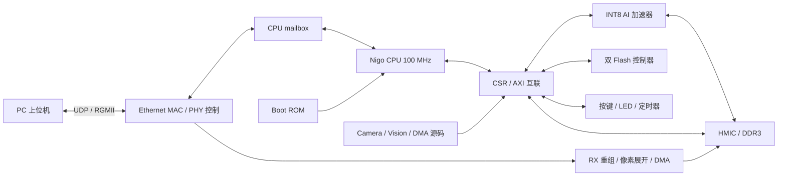

# 架构与模块索引

| 代码入口 | 作用 |
|---|---|
| `rtl/pg2l100h_soc_rx_top.v` | P3 板级顶层，系统 PLL、DDR、复位、按键同步、RGMII、Flash pads |
| `rtl/pg2l100h_soc_core_rx.v` | CPU、CSR、AXI、AI、DMA、DDR 访问和 ROM 的整合 |
| `rtl/NaxRiscvContest.v` | 当前 Nigo CPU 生成 RTL |
| `rtl/ai_accel/`、`rtl/ai_native_csr_bridge.sv` | AI 执行核心、tile/window/postprocess 和 CPU 调度接口 |
| `rtl/ethernet/`、`third_party/verilog-ethernet/` | MAC、UDP/IP/ARP、RGMII、MDIO、跨时钟和控制寄存器 |
| `rtl/ethernet_rx_*.sv`、`rtl/frame_buffer_manager.sv` | 图像包重组、接收状态、DMA、帧缓冲管理 |
| `rtl/flash_controller.sv`、`rtl/spi_transfer.sv` | Flash 命令、SPI 传输、保护和状态 |
| `rtl/pg2l100h_flash_pads.sv` | 实测修正的片选与 MISO 配对 |
| `rtl/pg2l100h_ddr3_wrapper.v`、`ip/ddr3_mes2l676/` | DDR3 HMIC、PHY 和初始化 |
| `rtl/camera/`、`rtl/vision/`、`rtl/operators/` | 预留摄像头链路与像素处理；当前顶层摄像头输入未接实物 |
| `firmware/bootloader/` | 网络恢复、CRC 下载、Flash A/B 应用选择与执行 |
| `upper/firmware/runtime/` | CPU 常驻模式管理与外设应用适配 |

Flash 实测逻辑 chip0：CS=P18、MOSI=R14、MISO=R15；chip1：CS=F25、MOSI=N16、MISO=N17。外部端口名保持原约束编号，pads 中对 MISO 进行对应配对。配置时钟使用厂商 GTP_CFGCLK。

当前板级复位由 reset_n、系统 PLL lock、DDR PLL lock 和 DDR init_done 共同控制，异步置位、同步释放；没有用于追溯这些触发源的历史记录寄存器。

原理图、开发板配套手册和 PDS 安装包不在仓库中。RTL 参数与板卡型号须与上述 LG100 平台一致。
